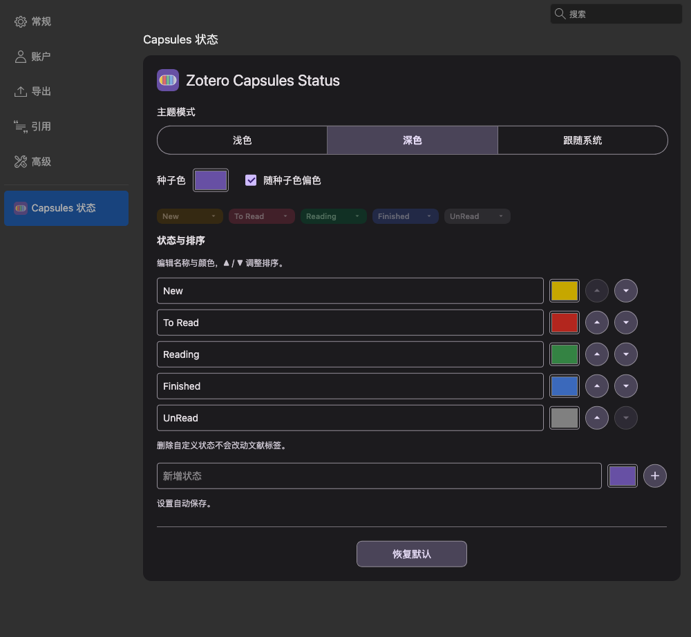
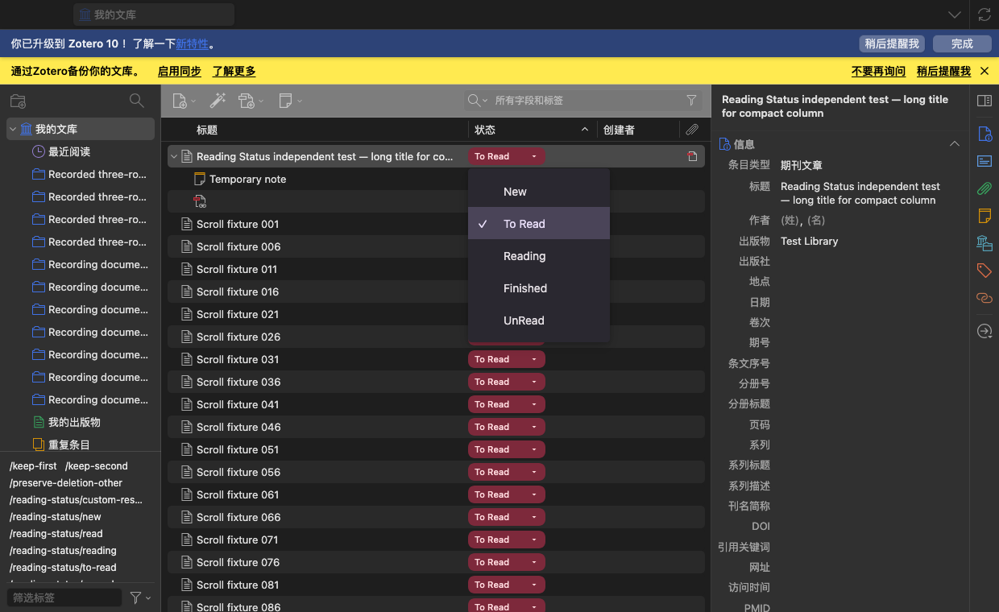
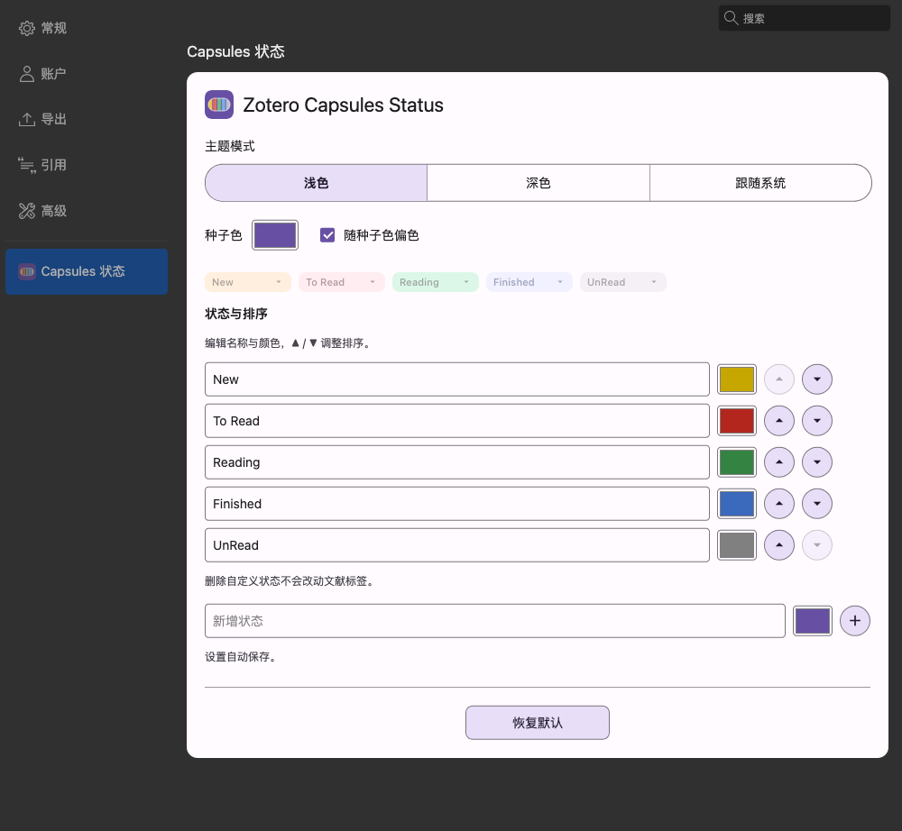

<div align="center">


# Zotero Capsules Status

Editable reading-status capsules for your Zotero library.

[简体中文](README.md) · [English](README.en.md)

[](LICENSE)


[](https://github.com/LiuAoran/zotero-veil)

[**Download XPI**](downloads/zotero-capsules-status-1.0.0.xpi)

</div>

---

An independent Material Design 3 reading-status plugin for Zotero 10, primarily on macOS.

## Preview

Screenshots use an isolated profile and synthetic test items. Theme settings apply only to this plugin's capsules, menu and preferences.



<details>
<summary>Library and light appearance</summary>




</details>

## Install

1. Download the [XPI](downloads/zotero-capsules-status-1.0.0.xpi), using **Download raw file** on GitHub.
2. In Zotero, open **Tools → Plugins → Install Plugin From File**.
3. Enable the status column and click a capsule to select a status.
4. Open **Settings → Capsules 状态** to customize appearance, statuses and sort order.

Install newer XPIs over the existing plugin. Preferences and item tags are retained. Updates are currently installed manually.

## Features

- Built-in labels: **New / To Read / Reading / Finished / UnRead**.
- Equal-width, left-aligned capsules with a nearby menu, keyboard controls and read-only feedback.
- Custom labels, colors and statuses; ▲ / ▼ reorder and − removes custom definitions.
- Light, dark and system modes; official Material Color Utilities palettes and optional seed-color harmonization.
- Confirmed reset to defaults and automatic preference saving.
- Child PDF rows read and edit their parent item's status; standalone attachments and notes are not editable.
- Virtualized rows, status sorting, external tag changes and Zotero undo.

## Data and compatibility

Status is stored in standard manual tags: `/reading-status/new`, `/reading-status/to-read`, `/reading-status/reading`, `/reading-status/read`, `/reading-status/unread`.

Items without a status display New without a library-wide write. Opening PDFs never changes status. Manual changes replace only recognized plugin status tags and preserve other tags and fields. Disabling/uninstalling, deleting custom definitions and resetting preferences retain existing library tags.

Targets Zotero 10.0.*, verified with macOS Zotero 10.0.6. Other platforms have not been fully verified. A short selection guard may correct programmatic selection changes during a menu/save and briefly afterward; user clicks, navigation keys and scrolling cancel it.

Runtime checks use isolated profiles, Gecko input events and controlled host selection restores. They do not establish physical mouse/trackpad coverage. See the [verification notes](docs/验证说明.md).

## Development

Requires Node.js, npm and Python 3:

```sh
npm ci --ignore-scripts
npm run check
npm test
npm run release
```

`dist/` contains the installable XPI, full source ZIP and checksums. The current XPI is also copied to `downloads/`. `addon/` holds static plugin files; `src/` holds implementation modules; `build/` is generated and ignored. Test instrumentation is written only to the temporary test profile, never the production XPI.

[Architecture](docs/架构.md) · [Testing](docs/测试指南.md) · [Release process](docs/发布说明.md)

## License

[MIT](LICENSE). Third-party notices are in [licenses/NOTICE.md](licenses/NOTICE.md).
