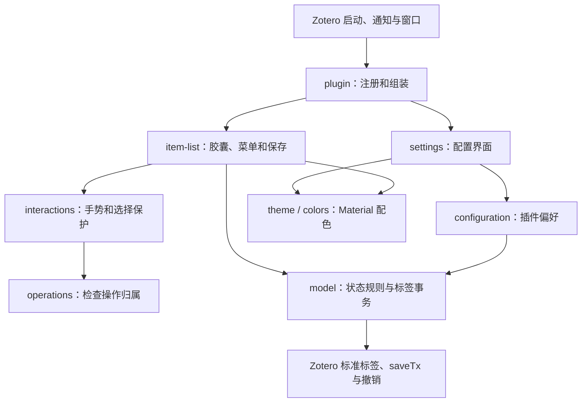

# Zotero Capsules Status 架构

1.0.0 是保留现有功能的内部整理版本。插件 ID、设置命名空间、存储标签、列名、设置页、默认状态及兼容行为保持不变，无数据迁移或批量文库写入。

## 模块职责

| 层 | 源文件 | 负责的事情 |
| --- | --- | --- |
| 生命周期 | `plugin.js`、`constants.js` | 组装控制器；注册/注销自定义列、设置页、Zotero 通知及偏好观察器；启动和停止窗口 |
| 状态与配置 | `model.js`、`configuration.js` | 状态定义、冲突优先级、排序、父子条目规则、标签替换与事务/撤销；读取和保存插件偏好 |
| 文献列表 | `item-list.js`、`zotero-adapter.js` | 胶囊、菜单、保存流程、按受影响条目合并刷新、焦点/滚动恢复；从真实宿主行解析文献身份 |
| 交互与资源 | `interactions.js`、`operations.js`、`scope.js` | 鼠标手势、重复释放保护、短期选择保护；统一检查异步操作是否仍属于当前用户输入；成组清理监听器 |
| 设置与外观 | `settings.js`、`theme.js`、`colors.js`、`styles.css`、`dom.js` | 状态编辑、三段主题选择、种子色/偏色、恢复默认；Material 配色、独立样式及公共图标创建 |

`addon/bootstrap.js` 只对接 Zotero 的启动、停止和窗口回调。开发时源文件分模块，构建时 esbuild 将它们与 Material Color Utilities 合为一个 `content/plugin.js`；插件运行不需要 Node.js 或源码模块加载器。

## 一次状态修改如何执行

1. 点击胶囊时，从实际列表行确认源文献 ID；PDF 行同时解析其父文献 ID。
2. 先选中点击的源文献，菜单记录源 ID、保存目标 ID、用户输入版本与操作序号。
3. 选择状态后，确认回调仍属于当前菜单。只对固定目标调用 `model.saveStatus()`，替换插件认识的专用标签，保留其他标签与字段，使用 Zotero 事务和撤销。
4. 保存过程中显示上次已提交的状态，防止临时内存变化被当成已保存结果。成功后刷新受影响文献的可见胶囊，失败恢复原标签并提示错误。
5. 排序可改变行号，因此任何后续选择、定位和焦点恢复都重新按 ID 查找；用户若已开始新的操作，旧操作不再接管选择或焦点。

未设置状态只计算显示 New；读状态本身不写入标签。冲突优先级与菜单/排序顺序分别维护：显示冲突优先级为 Reading、To Read、Finished、UnRead、自定义及已删除定义、New；用户主动选择状态时才清理该篇的专用冲突标签。

## 运行状态及其归属

- 插件运行信息只有 `alive`、资源路径与注册列键，由入口管理。
- 列表控制器拥有每个窗口的菜单、手势、选择保护及合并刷新任务；保存中的状态由目标文献 ID 索引。
- 设置控制器拥有各设置文档的重绘和清理句柄。主窗口和设置页不共享 DOM。
- `operations.js` 统一检查窗口实例、列表实例、用户输入版本与操作序号，替代此前在多个位置重复的条件。
- `scope.js` 将文档级手势监听、菜单监听与设置监听成组登记，关闭或禁用时一次释放，并允许重复清理。选择保护的观察器、动画帧与计时器仍按其短期生命周期释放。

## 保留的兼容保护及理由

- 鼠标按下和松开之间，虚拟列表可能替换胶囊节点：记录文献身份，在松开时验证当前实际节点，不使用旧节点或旧行号。
- macOS 可能有晚到的额外释放事件：保留手势去重，不让同一次操作重复保存或穿透选中另一行。
- 宿主可能恢复早先缓存的选择：保留菜单/保存阶段的选择保护，保存完成后 600 毫秒结束；主动点击、列表导航键、滚动、失焦或禁用立即取消。
- 两次异步保存交错：旧保存只处理自己的保护与菜单，不清理后来打开的菜单。

这次没有凭“可能是观察误差”删掉已有保护，而是明确其责任和退出条件。没有用户输入事件的程序选择，在短暂保护期间仍可能被纠正，这是沿用的现有边界。

## 后续维护方式

改状态/标签规则优先改 `model.js`；改种子色算法改 `colors.js`；改设置页改 `settings.js` 与 `addon/content/preferences.xhtml`；改鼠标或选择行为改 `interactions.js`，避免在入口增加临时判断。宿主行身份规则集中在 `zotero-adapter.js`；部分列位置和排序接口仍由列表/入口使用，尚未把所有宿主 API 都包装成适配层。

使用 `npm run format` / `npm run check` 保持源码排版，`npm test` 验证规则与操作归属，`npm run build` 生成 XPI。打包和隔离测试脚本从 `addon/manifest.json` 读取版本，避免每次发版手动更新多个文件名。所有真实测试仍只使用 `/tmp/reading-status-live` 中的临时配置和测试条目。

窗口启动通过宿主 UI 就绪信号延后初始化，不阻塞启动；列表和排序上下文就绪后，若当前列为“状态”，执行一次宿主排序，使恢复的列标记与行顺序同步。普通状态保存不增加额外排序。
